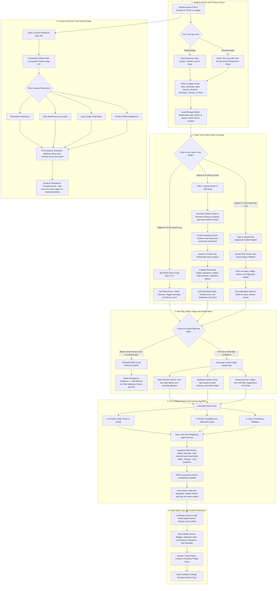

<div align="center">


# Call of Doodie 💩


[](https://www.fandm.edu)
[](https://vitejs.dev/)
[](https://react.dev/)
[](https://www.typescriptlang.org/)
[](https://tailwindcss.com/)
[](LICENSE)

[Features](#-key-features) • [System Flowchart](#-how-call-of-doodie-works-complete-architecture) • [House Cup](#-college-house-cup) • [Map & Restrooms](#-campus-restroom-finder) • [Privacy First](#-privacy--safety-first) • [Theme System](#-7-candy-palettes--dark-mode) • [Quick Start](#-quick-start)

</div>

---

## What is Call of Doodie?

Poop is a big part of our daily life and well being. 

How easily and regularly your body digests food is one of the clearest signs of how well you're resting and drinking water. It tells doctors about our overall health, and you probably remember how good you felt after a good poop day. So why don't we talk about it? 

In college, life is busy and stressful. Late-night study sessions in Shadek, D-Hall food, and midterm crunch times can mess with your sleep, water habits, and digestion. 

**Call of Doodie** makes tracking your routine simple, private, and fun for F&M students. Check in daily, compete anonymously for your college house, and find the cleanest, nearest restroom anywhere on campus! 

---

## Key Features

### 🏆 College House Cup

- **8 campus buildings**: Ware College House, Bonchek College House, Weis College House, Brooks College House, Roschel College House, Schnader Hall, Thomas Hall, and Dietz Hall.  
- **Fair Evaluation**: Balanced for different dorm populations so smaller halls like Dietz compete on equal footing with large houses like Ware\!  
- **Rewarding Habits, Not Perfection**: Points reward regular logging and self-care, never penalizing students.  
- **100% Anonymous**: Only total community points and participation rates appear on the leaderboard, never personal logs or names\!

### 🗺️ Campus Restroom Finder

- **Interactive Campus Spatial Map**: Official Franklin & Marshall College Concept3D interactive map embedded right in the app.  
- **Smart Filters**: Find All-Gender restrooms, ADA-accessible stalls, single-stall quiet spaces, and period product dispensers.  
- **Real-Time Student Cleanliness Reports**: Report needs like soap refills, cleaning requests, or plumbing fixes with one tap to keep campus clean.  
- **GPS Distance Estimator**: Displays walking distance in meters and minutes from anywhere on the Quad or across campus.  
- **Automatic Night Map**: Smoothly adapts to dark mode without harsh white map glare\!

### 📝 Private Daily Check-ins

- **10-Second Manual Log**: Tap your Bristol scale stool type (1 to 7), water intake, sleep hours, and daily stress level.  
- **AI Photo Check (Optional)**: Instant shape and digestion check powered by privacy-first vision. Images are blurred in memory immediately and **never stored to disk or uploaded to any server**.
- **Voice & Chat Log**: Simply type or speak how you feel (*"Slept 7 hours, drank 6 glasses of water, smooth digestion"*), and smart parsing fills out your daily form\!  
- **Helpful Post-Check-in Tips**: After every log, receive friendly, high-school-level wellness advice on water, fiber, and sleep to help you feel your best tomorrow.

---

## ⚡ How Call of Doodie Works (Complete Architecture)

Here is a full breakdown of how our app handles privacy, AI vision, voice parsing, health triage, fair House Cup scoring, and campus maps:



### 🔍 How Each Stage Works

1. **Student Access & Privacy First**: Students choose between **Playful Mode** (emojis, AI camera, and cheers) and **Discreet Mode** ("Gut Log" for quiet lecture halls). All health logs stay inside local browser storage.
2. **Triple-Track Check-In**: Students can log manually in 10 seconds, snap an optional blurred photo via **Gemini 3.5 Flash-Lite** (1.6-second speed, 500 free requests per day), or speak/type naturally to auto-fill the form.
3. **Safety Triage & Tips**: If red flags like bleeding or severe pain are logged, immediate emergency guidance pops up with one-tap calls to the F&M Diplomat Wellness Center and 911. Otherwise, students get personalized advice on sleep, water, and dining hall fiber.
4. **Fair House Cup Algorithm**: Points are weighted mathematically by dorm size, ensuring small dorms (Dietz, Thomas) compete fairly with massive houses (Ware, Bonchek). Leaderboards are 100% anonymous.
5. **Campus Restroom Finder**: Integrates F&M's official Concept3D map, calculates walking distances across campus, filters by ADA/gender neutrality, and crowdsources soap/cleanliness reports.
6. **Habit Loop**: Keeps students coming back with Apple-style tactile physics, streak badges, 7-day health charts, and confetti celebrations.

---

## Two Interface Vibes

We know you might be checking in while sitting with roommates in Hartman Green, or quietly during a lecture in Keiper:

| Vibe | Look & Feel | Best For |
| :---- | :---- | :---- |
| **💩 Playful** | Confetti, cheerful emojis, Bristol shapes, full AI tools, and house cheers\! | Relaxing in your dorm, celebrating streaks, and having fun with campus friends. |
| **🌿 Discreet** | Minimalist look named "Gut Log", no jokes or poop emojis, AI tools disabled. | Quiet in-class logs, library check-ins, and zero-distraction wellness tracking. |

---

## Palettes & Dark Mode

Pick your favorite color in **Settings & Preferences**! The app updates cleanly with smooth Apple styling:

- 🍑 **Warm Peach** · Cozy, energetic sunset orange  
- 🎓 **Diplomat Blue** · Proud F&M True Blue  
- 🍵 **Fresh Matcha** · Calm soothing sage green  
- 💜 **Royal Lavender** · Elegant iris purple  
- 🍯 **Sunset Amber** · Golden hour warm honey  
- 🌸 **Cherry Blossom** · Soft strawberry rose pink  
- 🌊 **Ocean Teal** · Crisp Pacific breeze cyan

> **Dark Mode:** Supports **Auto (Matches Device)**, **Light Mode**, and **Dark Mode**.

---

## Privacy & Safety First

1. **Zero-Disk Photo Stream**: Camera checks analyze images purely in temporary device memory (RAM). Photos are blurred right away and deleted immediately after grading.  
2. **Local Session Protection**: Personal health logs stay private in your local browser storage.  
3. **Red Flag Health Alerts**: If you log warning signs like bad stomach pain or unusual symptoms, the app shows helpful tips and one-tap contact buttons for F&M Student Wellness (Diplomat Center) and 911.

---

## 🛠️ Tech Stack

- **Frontend Core**: React 19 \+ TypeScript \+ Vite 8  
- **Styling**: Tailwind CSS v4 with custom CSS Apple design tokens  
- **Icons & Visuals**: Handcrafted Apple Bristol SVGs \+ Lucide React \+ Canvas Confetti  
- **Typography**: `@fontsource/nunito` (200-900 weights)  
- **Map System**: Concept3D Spatial API Embed (Layers 32461 & 57938\)  
- **AI Engine (Opt-in)**: Google GenAI SDK (`@google/genai` Gemini 3.5 Flash-Lite / 500 RPD free tier)

---

## 🚀 Quick Start

### 1\. Clone the repository

```sh
git clone https://github.com/Real-JasonWang/fandm_hacks_COD.git
cd fandm_hacks_COD
```

### 2\. Install dependencies

```sh
npm install
```

### 3\. Start local development server

```sh
npm run dev
```

Open `http://localhost:5173` in your browser\!

### 4\. Build for production

```sh
npm run build
```

---

## 🏛️ Franklin & Marshall College Houses & Halls

- 💜 **Roschel College House**  
- ❤️ **Bonchek College House**  
- 💛 **Brooks College House**  
- 💙 **Ware College House**  
- 💚 **Weis College House**  
- 🔷 **Schnader Hall**  
- 🟢 **Thomas Hall**  
- 🍊 **Dietz Hall**