<div align="center">


# Call of Doodie 💩


[](https://www.fandm.edu)
[](https://vitejs.dev/)
[](https://react.dev/)
[](https://www.typescriptlang.org/)
[](https://tailwindcss.com/)
[](LICENSE)

[Features](#-key-features) • [System Flowchart](#-system-architecture-flowchart) • [AI Precision Pipeline](#-ai-precision-vision-pipeline) • [House Cup](#-college-house-cup) • [Map & Restrooms](#-campus-restroom-finder) • [Privacy First](#-privacy--safety-first) • [Theme System](#-7-candy-palettes--dark-mode) • [Quick Start](#-quick-start)

</div>

---

## What is Call of Doodie?

Poop is a big part of our daily life and well being. 

How easily and regularly your body digests food is one of the clearest signs of how well you're resting and drinking water. It tells doctors about our overall health, and you probably remember how good you felt after a good poop day. So why don't we talk about it? 

In college, life is busy and stressful. Late-night study sessions in Shadek, D-Hall food, and midterm crunch times can mess with your sleep, water habits, and digestion. 

**Call of Doodie** makes tracking your routine simple, private, and fun for F&M students. Check in daily, compete anonymously for your college house, and find the cleanest, nearest restroom anywhere on campus! 

---

## Key Features

### 🏆 College House Cup

- **8 campus buildings**: Ware College House, Bonchek College House, Weis College House, Brooks College House, Roschel College House, Schnader Hall, Thomas Hall, and Dietz Hall.  
- **Fair Evaluation**: Balanced for different dorm populations so smaller halls like Dietz compete on equal footing with large houses like Ware\!  
- **Rewarding Habits, Not Perfection**: Points reward regular logging and self-care, never penalizing students.  
- **100% Anonymous**: Only total community points and participation rates appear on the leaderboard, never personal logs or names\!

### 🗺️ Campus Restroom Finder

- **Interactive Campus Spatial Map**: Official Franklin & Marshall College Concept3D interactive map embedded right in the app.  
- **Smart Filters**: Find All-Gender restrooms, ADA-accessible stalls, single-stall quiet spaces, and period product dispensers.  
- **Real-Time Student Cleanliness Reports**: Report needs like soap refills, cleaning requests, or plumbing fixes with one tap to keep campus clean.  
- **GPS Distance Estimator**: Displays walking distance in meters and minutes from anywhere on the Quad or across campus.  
- **Automatic Night Map**: Smoothly adapts to dark mode without harsh white map glare\!

### 📝 Private Daily Check-ins

- **10-Second Manual Log**: Tap your Bristol scale stool type (1 to 7), water intake, sleep hours, and daily stress level.  
- **AI Photo Check (Optional)**: Instant shape and digestion check powered by privacy-first vision. Images are blurred in memory immediately and **never stored to disk or uploaded to any server**.
- **Voice & Chat Log**: Simply type or speak how you feel (*"Slept 7 hours, drank 6 glasses of water, smooth digestion"*), and smart parsing fills out your daily form\!  
- **Helpful Post-Check-in Tips**: After every log, receive friendly, high-school-level wellness advice on water, fiber, and sleep to help you feel your best tomorrow.

---

## ⚡ Architecture Flowchart

```mermaid
flowchart TD
    %% 1. STUDENT ONBOARDING & PRIVACY VAULT
    subgraph S1["1. Student Access & Privacy Shield"]
        A1["Student Opens Call of Doodie on Phone or Laptop"] --> A2{"Choose Your App Vibe"}
        A2 -->|"💩 Playful Mode"| A3["Full Fun Vibe: Emojis, Confetti, Badges, and AI Tools"]
        A2 -->|"🌿 Discreet Mode"| A4["Minimalist 'Gut Log': Zero Emojis, Quiet for Class, AI Disabled"]
        A3 --> A5["Select College House or Hall (Ware, Bonchek, Weis, Brooks, Roschel, Schnader, Thomas, Dietz)"]
        A4 --> A5
        A5 --> A6{"Choose Login Method"}
        A6 -->|"1-Click Test Demo"| A7["Instant Demo Session: diplomat@fandm.edu"]
        A6 -->|"Private Student Auth"| A8["Student Email Login: @fandm.edu"]
        A7 --> A9["Local Device Vault: All health logs saved in browser storage with Zero Tracking"]
        A8 --> A9
    end

    %% 2. 3-WAY INPUT ENGINE
    subgraph S2["2. 3-Way Daily Check-In Engine"]
        A9 --> B0{"How do you want to check in today?"}
        
        %% Option A: 10-Second Quick Log
        B0 -->|"Option A: 10-Sec Quick Log"| B1["Bristol Stool Scale Slider: Tap Type 1 to 7"]
        B1 --> B2["Sleep Hours Slider (0 to 14 Hours)"]
        B2 --> B3["Water Tracker (1 to 10 Glasses)"]
        B3 --> B4["Dining Hall Veggie Counter (0 to 10 Servings)"]
        B4 --> B5["Daily Stress Level (Calm, Okay, Meh, Stressed, Overwhelmed)"]
        
        %% Option B: AI Vision Photo Check
        B0 -->|"Option B: AI Photo Check"| C1["Take or upload photo of toilet bowl"]
        C1 --> C2["Zero-Disk Shield: Photo is blurred in memory instantly and never written to disk"]
        C2 --> C3["AI Vision Precision Pipeline (See Detailed AI Flowchart Below)"]
        C3 --> C4["Auto-fills Bristol Type, Soiling Level, and Symptoms into Form"]
        
        %% Option C: Voice & NLP Chat Log
        B0 -->|"Option C: Voice & Chat Log"| D1["Type or speak what happened in plain English"]
        D1 --> D2["Gemini NLP Parser with Smart Regex Fallback"]
        D2 --> D3["Extracts Sleep, Water, Veggies, Stress, and Digestion details"]
        D3 --> D4["Auto-populates check-in fields for quick student review"]
    end

    %% 3. SAFETY TRIAGE & HEALTH GUIDANCE
    subgraph S3["3. Red Flag Health Triage & Daily Advice"]
        B5 --> E1{"Scan for Critical Warning Signs"}
        C4 --> E1
        D4 --> E1
        
        E1 -->|"Blood, dark tarry stool, or severe pain"| E2["TRIGGER RED FLAG HEALTH ALERT"]
        E2 --> E3["Instant Emergency Guidance + 1-Tap Call to F&M Wellness Center and 911"]
        
        E1 -->|"Normal or mild daily symptoms"| F1["Personalized Daily Advice Engine"]
        F1 --> F2["Sleep Rhythm Guidance: How sleep cycles affect gut digestion"]
        F1 --> F3["Hydration Tips: Water balance based on stool moisture"]
        F1 --> F4["Dining Hall Tips: Salad, fruit, and fiber suggestions for D-Hall"]
        F1 --> F5["Stress Relief: 5-minute breathing break when stress is high"]
    end

    %% 4. FAIR HOUSE CUP ALGORITHM
    subgraph S4["4. Fair College House Cup Scoring Algorithm"]
        F2 --> G1["Calculate Daily Points"]
        F3 --> G1
        F4 --> G1
        F5 --> G1
        
        G1 --> G2["+10 Points: Daily Check-In Streak"]
        G1 --> G3["+5 Points: Hydration Goal (6+ glasses)"]
        G1 --> G4["+5 Points: Fiber & Balanced Meal Goal"]
        G1 --> G5["3+ Days Consistency Multiplier: Unlocks House Cup Points"]
        
        G2 --> H1["Dorm Size Fair-Weighting Formula"]
        G3 --> H1
        G4 --> H1
        G5 --> H1
        
        H1 --> H2["Equalizes Large Houses (Ware, Bonchek ~350 students) and Small Halls (Dietz, Thomas ~100 students)"]
        H2 --> H3["100% Anonymous House Leaderboard Update"]
        H3 --> H4["Only House Totals are displayed; individual names and logs are never visible"]
    end

    %% 5. CAMPUS RESTROOM DISCOVERY & CROWDSOURCING
    subgraph S5["5. Campus Restroom Finder & Facility Map"]
        A1 --> M1["Open Campus Restroom Map Tab"]
        M1 --> M2["Embedded Official F&M Concept3D Campus Map API"]
        M2 --> M3{"Filter Campus Restrooms"}
        M3 --> M4["All-Gender Restrooms"]
        M3 --> M5["ADA Wheelchair Accessible"]
        M3 --> M6["Quiet Single-Stall Spots"]
        M3 --> M7["Period Product Dispensers"]
        
        M4 --> M8["GPS Distance Estimator: Walking meters and minutes from anywhere on the Quad"]
        M5 --> M8
        M6 --> M8
        M7 --> M8
        
        M8 --> M9["Student Cleanliness Crowdsourcing: 1-tap report for soap refill, paper shortage, or cleaning needed"]
    end

    %% 6. HABIT LOOP & REWARDS
    subgraph S6["6. Daily Habit Loop & Student Rewards"]
        H4 --> R1["Celebrate Check-In with Tactile Apple Bouncy Physics and Confetti"]
        R1 --> R2["Earn Weekly House Badges: Hydration Hero, Consistency Champion, Gut Guardian"]
        R2 --> R3["Review 7-Day History Trends in Personal Private Diary"]
        R3 --> R4["Build Healthier College Routines Day by Day!"]
    end
```



---

## 🔬 AI Precision Pipeline

```mermaid
flowchart TD
    %% STAGE A: CLIENT PRE-PROCESSING
    subgraph A["Stage A: Client-Side Pre-Flight & Privacy Shield"]
        P1["Student Takes or Uploads Photo in Toilet Bowl"] --> P2["HTML5 Canvas In-Memory Ingestion (RAM Only)"]
        P2 --> P3["EXIF & Metadata Stripping: Removes GPS coordinates, timestamp, and device info"]
        P3 --> P4["Instant Gaussian Privacy Blur (40px) Applied on UI"]
        P4 --> P5["Zero-Disk Guarantee: Photo is never saved to phone storage or cloud storage"]
    end

    %% STAGE B: ANTI-SPOOFING & ENVIRONMENT VERIFICATION
    subgraph B["Stage B: Anti-Spoofing & Context Verification"]
        P5 --> Q1["Toilet Bowl Context Scanner"]
        Q1 --> Q2{"Is this a real bowel movement in a toilet bowl?"}
        Q2 -->|"Fake object: melted chocolate, toy, food, or non-toilet"| Q3["Flag as Invalid: isValid = false"]
        Q3 --> Q4["Prompt Student: 'Please upload a clear photo of a bowel movement in a toilet bowl'"]
        Q2 -->|"Real toilet bowl sample confirmed"| Q5["Pass to Multi-Spectral AI Vision Core"]
    end

    %% STAGE C: MULTI-SPECTRAL MORPHOLOGY
    subgraph C["Stage C: Morphology & Edge Contour Analysis"]
        Q5 --> R1["Contour & Edge Segmentation"]
        R1 --> R2["Shape Classification: Nut-like lumps vs sausage log vs soft blobs vs liquid"]
        R2 --> R3["Surface Texture Mapping: Smooth surface vs surface cracks vs ragged mushy edges"]
        R3 --> R4["Particle Cohesion Index: Checks if stool holds together or breaks into chunks"]
    end

    %% STAGE D: TOILET WATER DYNAMICS
    subgraph D["Stage D: Water Dynamics & Moisture Index"]
        R4 --> S1["Toilet Water Cloudiness Scanner"]
        S1 --> S2["Moisture & Dissolution Rate: Clean water (solid) vs cloudy bowl (rapid breakdown)"]
        S2 --> S3["Buoyancy & Density Estimator: Dense sinker vs neutral float vs liquid suspension"]
        S3 --> S4["Soiling Level Calculation: Rates cleanup need from 0 (clean) to 5 (heavy)"]
    end

    %% STAGE E: 4-STAGE REASONING
    subgraph E["Stage E: 4-Stage Visual Chain-of-Thought (CoT) Differential Matrix"]
        S4 --> T1["Stage 1 Morphology: Shape, edge consistency, and surface crack analysis"]
        T1 --> T2["Stage 2 Moisture: Interaction with toilet bowl water and particle integrity"]
        T2 --> T3["Stage 3 Differential Diagnosis: Explains why it is this type and rules out adjacent types"]
        T3 --> T4["Stage 4 Digestion Speed: Translates shape into digestion speed (slow, optimal, or fast)"]
        T4 --> T5["Bristol Stool Scale Matching: Selects exact Bristol Number 1 to 7"]
    end

    %% STAGE F: CALIBRATION & AUTO-FILL
    subgraph F["Stage F: Confidence Calibration & Structured Auto-Fill"]
        T5 --> U1["Confidence Score Calibration (0.0 to 1.0)"]
        U1 --> U2["Symptom Detection: Detects bloating, straining, urgency, or irregularities"]
        U2 --> U3["Hydration Alert Engine: OPTIMAL, DEHYDRATED, CRITICAL_DRY, or NORMAL"]
        U3 --> U4["Strict JSON Schema Validation (Zero Markdown Backticks)"]
        U4 --> U5["Auto-Fills Daily Check-In Form with Bristol Type, Confidence %, and Tips"]
        U5 --> U6["RAM Purge: In-memory image buffer instantly destroyed upon analysis completion"]
    end
```



### 🔬 How the Photo Check Works

1. **Temporary image processing**: The photo is read into device memory through an HTML5 canvas. EXIF metadata, such as location and camera information, is removed before analysis. The app also blurs the preview on screen. The image is not saved by this feature.
2. **Basic image validation**: The vision model first checks whether the image shows a toilet-bowl sample. If the image shows an unrelated object or cannot be checked clearly, it returns `isValid = false` and asks the student to try again.
3. **Shape and surface analysis**: The model uses image segmentation and morphology to study the sample's outline and texture. It looks for features such as a smooth surface (Type 4), cracks (Type 3), separate lumps (Type 1), or other patterns from the Bristol Stool Scale.
4. **Moisture clues**: The model also checks visible signs of moisture, such as whether the sample keeps its shape, breaks apart, or makes the water look cloudy. These clues help distinguish formed stool from mushy or liquid stool.
5. **Structured classification**: The result is compared with the Bristol Stool Scale and returned as structured JSON. The app records the suggested type, confidence score, and basic observations instead of presenting the model's hidden internal reasoning as fact.
6. **Model and response time**: The feature uses **Gemini 3.5 Flash-Lite** when the optional AI service is enabled. Response time and daily request limits depend on the network, API configuration, and service availability.

---

## Two Interface Vibes

We know you might be checking in while sitting with roommates in Hartman Green, or quietly during a lecture in Keiper:

| Vibe | Look & Feel | Best For |
| :---- | :---- | :---- |
| **💩 Playful** | Confetti, cheerful emojis, Bristol shapes, full AI tools, and house cheers\! | Relaxing in your dorm, celebrating streaks, and having fun with campus friends. |
| **🌿 Discreet** | Minimalist look named "Gut Log", no jokes or poop emojis, AI tools disabled. | Quiet in-class logs, library check-ins, and zero-distraction wellness tracking. |

---

## Palettes & Dark Mode

Pick your favorite color in **Settings & Preferences**! The app updates cleanly with smooth Apple styling:

- 🍑 **Warm Peach** · Cozy, energetic sunset orange  
- 🎓 **Diplomat Blue** · Proud F&M True Blue  
- 🍵 **Fresh Matcha** · Calm soothing sage green  
- 💜 **Royal Lavender** · Elegant iris purple  
- 🍯 **Sunset Amber** · Golden hour warm honey  
- 🌸 **Cherry Blossom** · Soft strawberry rose pink  
- 🌊 **Ocean Teal** · Crisp Pacific breeze cyan

> **Dark Mode:** Supports **Auto (Matches Device)**, **Light Mode**, and **Dark Mode**.

---

## Privacy & Safety First

1. **Zero-Disk Photo Stream**: Camera checks analyze images purely in temporary device memory (RAM). Photos are blurred right away and deleted immediately after grading.  
2. **Local Session Protection**: Personal health logs stay private in your local browser storage.  
3. **Red Flag Health Alerts**: If you log warning signs like bad stomach pain or unusual symptoms, the app shows helpful tips and one-tap contact buttons for F&M Student Wellness (Diplomat Center) and 911.

---

## 🛠️ Tech Stack

- **Frontend Core**: React 19 \+ TypeScript \+ Vite 8  
- **Styling**: Tailwind CSS v4 with custom CSS Apple design tokens  
- **Icons & Visuals**: Handcrafted Apple Bristol SVGs \+ Lucide React \+ Canvas Confetti  
- **Typography**: `@fontsource/nunito` (200-900 weights)  
- **Map System**: Concept3D Spatial API Embed (Layers 32461 & 57938\)  
- **AI Engine (Opt-in)**: Google GenAI SDK (`@google/genai` Gemini 3.5 Flash-Lite / 500 RPD free tier)

---

## 🚀 Quick Start

### 1\. Clone the repository

```sh
git clone https://github.com/Real-JasonWang/fandm_hacks_COD.git
cd fandm_hacks_COD
```

### 2\. Install dependencies

```sh
npm install
```

### 3\. Start local development server

```sh
npm run dev
```

Open `http://localhost:5173` in your browser\!

### 4\. Build for production

```sh
npm run build
```

---

## 🏛️ Franklin & Marshall College Houses & Halls

- 💜 **Roschel College House**  
- ❤️ **Bonchek College House**  
- 💛 **Brooks College House**  
- 💙 **Ware College House**  
- 💚 **Weis College House**  
- 🔷 **Schnader Hall**  
- 🟢 **Thomas Hall**  
- 🍊 **Dietz Hall**

---

## ❓ Frequently Asked Questions (Judge Q&A)

### 1. "Why is this built local-first instead of saving all user data to a central cloud backend?"
**Because privacy comes first.** Digestive health, bathroom habits, and photos are deeply personal. If we asked college students to upload their bathroom logs to a remote database on day one, nobody would feel safe using the app. By using a **Local-First, Zero-Knowledge architecture** with browser IndexedDB and Web Crypto (PBKDF2-HMAC-SHA256), your health logs never leave your phone or laptop. 

For our upcoming V2 campus sync, we already planned out a Supabase backend using Row-Level Security (RLS). The key difference is that **only anonymized house points** (like `+10 points to Ware House`) will be sent to the cloud leaderboard via edge functions. Personal notes, photos, and time logs will stay encrypted on-device.

---

### 2. "Isn't turning bathroom habits into a dorm competition a little weird or gross?"
**That taboo is exactly why so many students have stomach issues.** When freshmen come to college, changes in cafeteria food, late-night study snacks, dehydration, and exam stress mess up their digestive system. But because nobody talks about it, people ignore problems until they get sick. By giving it a lighthearted Apple-style design and friendly dorm pride, we take away the awkwardness and turn daily hydration and gut health into a fun, healthy routine.

---

### 3. "Won't big dorms like Ware always beat smaller dorms because they have more students?"
**Nope, our math prevents that.** The House Cup does not just add up raw points. We built a fair-share weighting formula that divides total house points by the number of active participants, plus a consistency bonus for daily streaks. A smaller dorm where 80% of residents log their water and meals regularly can easily beat a giant dorm where only a few people remember to check in.

---

### 4. "What if the AI vision model hallucinates or gives incorrect medical advice?"
**The AI never acts as a doctor or gives medical prescriptions.** It only looks for visual texture and consistency to suggest an approximate Bristol Stool Form Scale score (Types 1 to 7)—a standard chart created by medical researchers and used in hospitals worldwide. 

AI photo scanning is also completely optional; students can always slide the slider with one touch in two seconds. If someone reports red-flag symptoms like severe stomach pain or bleeding, the app skips AI advice and immediately displays direct one-tap buttons to call F&M Student Wellness (Diplomat Center) or 911.

---

### 5. "Isn't calling an AI vision model on images slow and expensive?"
**Not the way we built it.** We use Google's latest `gemini-3.5-flash-lite`, which responds in under 1.6 seconds and comes with a 500-requests-per-day free tier. Before any image is sent, client-side HTML5 canvas compresses it down to 600px width at 0.6 JPEG quality, making the upload lightweight. We also wrap every call in a 12-second safety timeout, so the app never hangs even on spotty dorm Wi-Fi.

---

### 6. "What if a student wants to check in during a crowded lecture or the library? Isn't the screen embarrassing?"
**We built Discreet Mode specifically for this.** With one tap in Settings, the app switches into "Classroom Privacy Shield." The poop character, funny badges, and bathroom terms disappear, turning the UI into a clean, minimalist pastel "Daily Hydration & Energy Log." Anyone sitting next to you will just think you are tracking your study goals or daily water intake.

---

### 7. "Why build a Progressive Web App (PWA) instead of a native iOS or Android app?"
**Friction kills student adoption.** If you stick a poster on a bathroom stall door saying "Download an 80MB app from the App Store and create an account," 90% of students will walk away. With our PWA, a student scans a QR code, the web page loads in under one second on any phone, and they can tap "Add to Home Screen" right away. No app store waiting, no installation barrier, and zero device lock-in.

---

### 8. "Are the 23 campus restrooms real, or did you make up the map data?"
**Every single bathroom is real and mapped directly from Franklin & Marshall grounds.** We walked through and verified locations across the Quad, Martin Science Center, Stager Hall, the library, and residential buildings. Each spot lists real floor numbers, single-stall privacy status, wheelchair accessibility, and gender-neutral labels, all embedded alongside the official F&M Concept3D campus interactive map.

---

### 9. "Can someone cheat the House Cup by spamming hundreds of check-ins in five minutes?"
**No, there is a biological cooldown limit.** The scoring system only awards House Cup points for up to 3 check-ins per day (Morning, Afternoon, and Evening). If you try to submit ten check-ins in an hour, the app saves your health log for your personal record but awards 0 extra house points. Real habits beat spamming every time.

---

### 10. "Is this just a 24-hour hackathon joke, or can this actually keep running at F&M?"
**The architecture was designed for real-world campus life.** The code is modular, fully typed in TypeScript, and runs cleanly with high-speed Vite bundling. 

Our roadmap after the hackathon includes:
1. **Physical NFC tags** placed on dorm bathroom mirrors for instant one-tap check-in.
2. **Supabase Realtime backend** for live campus Quad scoreboards.
3. **Dining Hall collaboration**, sharing anonymous, high-level digestion trends (e.g., "70% of students experienced dehydration during finals week") with F&M Dining to encourage more water stations and fresh greens.
